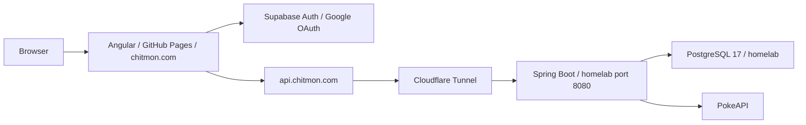

# Personal site architecture

Updated for the removal of shipment tracking on 2026-10-20. Runtime observations below were collected before the removal was deployed and are a dated snapshot; recheck before changing infrastructure.

## System overview

The frontend lives in `personal-site`; the Java backend lives in the sibling `personal-site-service` repository. Supabase provides hosted authentication and the existing storage/edge-function integration. Application tables live in the separate homelab PostgreSQL database.

The public `/supabase/...` routes are an additional routing path: the resume PDF and random-cat JSON both returned HTTP 200 publicly, while the same paths returned 404 directly from Spring Boot. This confirms public routing outside the Spring application. Its exact implementation/configuration was not inspected; do not assume these routes are broken or add duplicate Spring proxy endpoints without investigating that routing first.

## Frontend

- Angular 22, TypeScript 6, zoneless change detection, standalone components, and `OnPush`.
- Optimus UI 2 (`@openng/optimus-ui`) with Aura, SCSS, and Inter. Shared utility styles live in `src/styles.scss`.
- `src/app/core`: application configuration, routes, navigation, footer, and home page.
- `src/app/features`: lazy-loaded blog (`/chittyblog`), cat generator (`/cat`), and admin area (`/admin`, including `/admin/pokeplayground`). The Pokémon physics canvas lives within the admin feature.
- `src/app/shared`: authentication, typed API clients/models, reusable UI, pipes, and services.

Stateful features follow **component → facade → store/API service**. Stores own signals and state transitions; facades coordinate requests and business behavior. Prefer component-scoped stores/facades for feature state, with root services for shared authentication and API access. The Pokémon playground and home page demonstrate this pattern. Existing code has some older patterns; follow the current repository conventions for new work.

New forms should use `@angular/forms/signals`. Blog search still uses an older `FormControl` implementation. The retired shipment form and its unused validation directive/styles have been removed; there is currently no Signal Forms reference implementation in the repository.

### HTTP clients

`ApiService` wraps `HttpClient` GET and POST and accepts complete URLs or relative asset paths; it does not prepend an API host.

- Pokémon and user sync use `environment.apiBase`: `http://localhost:8080` in development and `https://api.chitmon.com` in production. Angular's production configuration replaces the environment file.
- The older `SupabaseApiService` uses the separate `API_URL` constant, currently `https://api.chitmon.com`, followed by `/supabase`. Cat and resume requests therefore still use the public API host during local development.
- Blog Markdown uses relative `blog/<post>.md` asset URLs.
- `authInterceptor` reads the Supabase session and attaches its access token only when a request URL starts with `environment.apiBase`.

### Authentication and authorization

`shared/auth/supabase-client.ts` creates the Supabase client. `AuthStore` initializes the session, listens for changes, starts Google OAuth with a redirect to the current origin, and calls `/me` once per distinct signed-in user. `AuthFacade` exposes sign-in state and checks `app_metadata.role === 'admin'` for admin UI access.

`adminGuard` waits for initial session lookup and protects admin routes. This is a UI control: backend authorization must be enforced independently for any sensitive API. The unused general auth guard was removed with shipment tracking.

### Blog and external assets

Posts and cover images live in `public/blog`. Build hooks run `npm-functions/generate-blog-manifest-ts.js`, which reads frontmatter, sorts posts newest first, and generates `src/app/shared/data/blog-manifest.ts`. Never edit the manifest manually. Posts are loaded at runtime and rendered with ngx-markdown/marked, Prism, and emoji support.

The resume client opens `/supabase/storage/v1/object/public/public-personal-site/resume.pdf`. The cat client calls `/supabase/functions/v1/random-cat-img`; its Deno source is in this repository's `supabase/functions` and calls TheCatAPI using a server-side key. Edge functions deploy separately from the Angular app.

## Backend and database

Java 21 / Spring Boot 4, Maven wrapper, Spring MVC, JPA, PostgreSQL 17, and Flyway. WebClient is used for external HTTP calls. Packages are organized by domain (`users`, `pokemon`), with shared configuration and security packages.

Spring runs as a stateless OAuth2 resource server. `JwtDecoderConfig` validates Supabase ES256 signatures through JWKS and checks issuer, expiry, and audience. `UserSyncFilter` runs after bearer authentication and upserts profile claims into `core.users` for authenticated requests. User metadata is used for profile fields; the frontend's admin decision uses app metadata.

`SecurityConfig` requires authentication for `/me` and `/users/**`; other routes are public. New private or admin endpoints need explicit backend rules. Shipment and carrier endpoints have been removed.

| Schema | Purpose |
| --- | --- |
| `core` | Mirrored Supabase user IDs and profile fields in `users`; shared identity for foreign keys. |
| `pokemon` | Bootstrap migration only; Pokémon responses currently come from PokeAPI without database persistence. |

`FlywayMultiSchemaConfig` migrates each managed schema independently from `src/main/resources/db/migration/<schema>`, with its own `flyway_schema_history`. Migrations run before JPA validation; Hibernate uses `ddl-auto: validate`. For an existing schema, add the next migration version. For a new schema, register it in `MANAGED_SCHEMAS` and add its migration directory. Do not edit already-applied migrations.

The retired `shipment_tracker` schema is no longer in `MANAGED_SCHEMAS`, so new databases do not create it and the application no longer uses or migrates it. Its already-applied V1 SQL is retained unchanged for history. Existing database tables and records are preserved; this code removal does not execute destructive SQL.

## Development and verification

- Frontend: `npm start`, `npm run lint`, `npm test -- --watch=false`, and `npm run build:prod`. Unit tests use Vitest through Angular's test builder; there is no configured end-to-end suite.
- Backend: `docker compose up --build` starts the app and PostgreSQL. For IDE development, run PostgreSQL in Docker and the app with `SPRING_PROFILES_ACTIVE=local`; that profile enables CORS for `http://localhost:4200`. Production CORS allows `https://chitmon.com`.
- The backend's local Compose override publishes PostgreSQL for development tools. Its production deployment copies only the base Compose file; the homelab has a separate loopback-only override.
- Backend automated test coverage is currently a Spring context-load test. The container build skips tests.

## Production and homelab

Frontend `.github/workflows/ci.yml` runs lint, unit tests, and a production build on pull requests to `main` (also manual runs). `.github/workflows/deploy.yml` builds and publishes to GitHub Pages on pushes to `main`. The build generates `404.html` for SPA routing. The custom domain is `chitmon.com`.

Backend pushes to `main` build an image published to `ghcr.io/austinchitmon/personal-site-service` with `latest` and commit tags. A self-hosted GitHub Actions runner on the homelab copies `docker-compose.yml` into `/opt/personal-site-service`, pulls images, and runs `docker compose up -d`.

Verified homelab snapshot:

- `ssh homelab`: Ubuntu 26.04 LTS at `192.168.40.182`, user `austin`.
- Spring Boot and `postgres:17-alpine` containers were healthy; both local and public `/actuator/health` returned `UP`.
- `cloudflared.service` routes `api.chitmon.com` to `http://localhost:8080` using `/etc/cloudflared/config.yml`.
- The application publishes port 8080. A manually managed `/opt/personal-site-service/docker-compose.override.yml` binds PostgreSQL to **127.0.0.1:5432** for SSH-tunneled administration. PostgreSQL is not published to the LAN.
- The self-hosted runner service is `actions.runner.austinchitmon-personal-site-service.homelab.service`.
- Before retirement, `core`, `pokemon`, and `shipment_tracker` had successful V1 migrations; `pokemon` contained only migration history. New installations now manage only `core` and `pokemon`.

The homelab guidance currently exists at `../homelab-playground/CLAUDE.md`; the `AGENTS.md` path mentioned in global instructions was absent during this review. Those server notes contain an older setup snapshot, so verify live state before relying on it. Preserve the manually managed production override and credentials; do not copy local development overrides into production.
