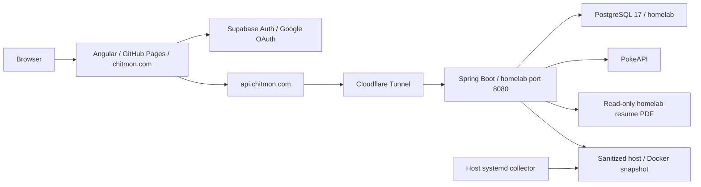

# Personal site architecture

Updated 2026-10-21 for protected homelab monitoring and retirement of the Cat integration demo. Runtime observations are dated snapshots; recheck before changing infrastructure. Deploy the new monitoring backend before merging/deploying its frontend consumer.

## System overview

The frontend lives in `personal-site`; the Java backend lives in the sibling `personal-site-service` repository. Supabase provides hosted authentication. The frontend no longer calls Supabase storage or edge-function proxy routes. Application tables live in the separate homelab PostgreSQL database.

Legacy public `/supabase/...` routes were observed outside Spring during the 2026-10-20 review. Their routing configuration was not inspected. The resume now uses the homelab file endpoint; the Cat demo has been retired.

## Frontend

- Angular 22, TypeScript 6, zoneless change detection, standalone components, and `OnPush`.
- Optimus UI 2 (`@openng/optimus-ui`) with Aura, SCSS, and self-hosted Jost, Limelight, and Yellowtail fonts. Shared utility styles live in `src/styles.scss`.
- The Miami theme registry and `ThemeService` in `core/theme` provide semantic CSS variables, a shared Optimus preset, and persistent appearance selection. See [design-system.md](design-system.md) for palette roles, contrast checks, and adding themes.
- `src/app/core`: application configuration, routes, navigation, footer, and home page.
- `src/app/features`: lazy-loaded blog (`/chittyblog`) and admin area (`/admin`, including `/admin/pokeplayground`). The Pokémon physics canvas lives within the admin feature.
- `src/app/shared`: authentication, typed API clients/models, reusable UI, pipes, and services.

Stateful features follow **component → facade → store/API service**. Stores own signals and state transitions; facades coordinate requests and business behavior. Prefer component-scoped stores/facades for feature state, with root services for shared authentication and API access. The Pokémon playground and blog demonstrate this pattern. The home facade/store coordinate resume download progress and failure feedback; its previous random-color timer remains removed. Existing code has some older patterns; follow the current repository conventions for new work.

New forms should use `@angular/forms/signals`. Blog search still uses an older `FormControl` implementation. The retired shipment form and its unused validation directive/styles have been removed; there is currently no Signal Forms reference implementation in the repository.

### HTTP clients

`ApiService` wraps `HttpClient` GET and POST and accepts complete URLs or relative asset paths; it does not prepend an API host.

- Pokémon and user sync use `environment.apiBase`: `http://localhost:8080` in development and `https://api.chitmon.com` in production. Angular's production configuration replaces the environment file.
- `ResumeApiService` uses `environment.apiBase` and `/files/resume.pdf`. It fetches the PDF as a Blob with a 15-second timeout and marks the request public, bypassing Supabase token/session lookup. The home facade saves valid PDF responses through `FileDownloadService`, prevents duplicate requests, and logs failures with HTTP status and the server reference when available. A page alert offers retrying; it also restores the button after errors.
- Blog Markdown uses relative `blog/<post>.md` asset URLs.
- `authInterceptor` reads the Supabase session and attaches its access token only when a request URL starts with `environment.apiBase` and is not marked with `PUBLIC_HTTP_REQUEST`.

### Authentication and authorization

`shared/auth/supabase-client.ts` creates the Supabase client. `AuthStore` initializes the session, listens for changes, starts Google OAuth with a redirect to the current origin, and calls `/me` once per distinct signed-in user. `AuthFacade` exposes sign-in state and checks `app_metadata.role === 'admin'` for admin UI access.

`adminGuard` waits for initial session lookup and protects admin routes. `adminChildGuard` checks again on navigation within the loaded admin area. Failed session initialization denies access. The monitoring facade also reacts to sign-out/role loss, clears private state, and cancels requests. These are UI controls: backend authorization is enforced independently for sensitive APIs. The unused general auth guard was removed with shipment tracking.

### Admin homelab dashboard

The Admin landing page links to lazy-loaded `/admin/homelab`. `HomelabComponent` uses a component-scoped `HomelabFacade` and `HomelabStore`; `HomelabApiService` calls the authenticated `GET /admin/homelab` endpoint through `environment.apiBase`. The page separates browser/API reachability, API/PostgreSQL connection validation, and host-collector freshness. It shows all running/stopped containers, healthchecks, CPU/memory, image IDs, restarts, exit codes, ports and cumulative network traffic, plus host CPU/load, memory/swap, root disk, uptime, Cloudflare Tunnel and deployment-runner service states.

Requests refresh every 15 seconds with an 8-second timeout, prevent overlap, pause in hidden tabs, and refresh on return. Manual refresh and auto-refresh pause controls are available. Up to 20 distinct fresh host samples form in-memory CPU/memory trends. A client clock keeps paused values aging: old snapshots and failed requests cannot remain styled as current. Last-known observations are retained on connectivity failure; authorization failures clear private data and stop polling. Metrics are not stored in browser storage or a time-series database.

Spring protects the entire `/admin` namespace using the existing Supabase JWT verification plus an authority derived only from server-managed `app_metadata.role == 'admin'`. Google sign-in without that role is insufficient. User-editable metadata and top-level JWT role do not grant admin access. Existing JWT expiry/refresh behavior applies to role changes. Responses are not cached.

A root-owned Python collector runs as `chitmon-monitor.service` from a 15-second systemd timer. It reads fixed Docker/proc/filesystem/service observations and atomically writes `/var/lib/chitmon-monitor/status.json`. The application mounts that directory read-only at `/app/homelab-monitor`; it receives no Docker socket or container-control capability. The snapshot excludes environment variables, credentials, logs, mounts and arbitrary labels. A missing/invalid snapshot is reported explicitly; snapshots older than 60 seconds or with excessive future clock skew are stale. Docker failure is distinct from a legitimate empty inventory.

The API's pooled database validation runs on one bounded worker, with a 2.5-second per-request wait and at most one attempt per 10 seconds. `/admin/homelab` skips `UserSyncFilter` writes while retaining JWT authorization, allowing database outages to be diagnosed. All other authenticated routes retain user sync. See the backend's `docs/homelab-monitoring.md` for installation, authorization, failure behavior, tests and operational commands.

The collector was installed and verified on 2026-10-21 without restarting existing services. Its snapshot showed the API and PostgreSQL containers healthy, and the tunnel and deployment runner active. The UI was verified with the real admin JWT and a temporary SSH-tunneled database connection. PostgreSQL stayed bound to homelab loopback only. Collector installation does not deploy the new backend or frontend; deploy the backend before the dashboard consumer.

### Blog and external assets

Posts and cover images live in `public/blog`. Build hooks run `npm-functions/generate-blog-manifest-ts.js`, which reads frontmatter, sorts posts newest first, and generates `src/app/shared/data/blog-manifest.ts`. Never edit the manifest manually. Posts are loaded at runtime and rendered with ngx-markdown/marked and Prism. Emoji conversion has been removed.

The resume client downloads `/files/resume.pdf` from the backend. Its fixed host file is `/srv/chitmon/public/resume.pdf`, mounted as a read-only directory into the application container; replacing the PDF atomically needs no rebuild/restart. The backend reads a bounded document on each request, checks its PDF header, and sends an attachment response with `Cache-Control: no-store`. Errors receive a generic 503 and an `X-Request-Id`; server logs retain the filesystem exception and matching reference. A filter also logs response-delivery exceptions. CORS exposes the reference header to the frontend. See the sibling backend's `docs/resume-download.md` for update and debugging commands.

`/resume` is the shareable frontend download route. Its lazy-loaded `ResumeDownloadComponent` starts the download after the first browser render (`afterNextRender`). The page shows a themed “Thank You!” with sequential letter hops and a faint text-only download button that fades in after 2.5 seconds. Motion stops and the button appears immediately under reduced-motion preferences; keyboard focus makes the button fully legible. It reuses the home facade/store with a separate component-scoped instance, retaining the same timeout, validation, and logging; error feedback is announced to screen readers without adding visible copy. Browser download restrictions can require using the manual button. `build:prod` runs `npm-functions/generate-resume-entry.js` to write `resume/index.html` from the built application shell, giving direct GitHub Pages visits a real entry file; `/resume/` redirects to the canonical `/resume` Angular route.

The initial public Supabase PDF was copied to the homelab on 2026-10-21 and read-only container access verified. The old Supabase object is preserved for rollback. The deployed `/files/resume.pdf` endpoint was verified publicly on 2026-10-21: HTTP 200, `application/pdf`, 83,629 bytes, attachment disposition, and `Cache-Control: no-store`.

The Cat API-integration demo is retired. Its navigation entry, `/cat` route, components/store/services, unused Supabase proxy client and fixed API URL, edge-function source/configuration, and function-specific npm scripts/helper have been removed. The deployed `random-cat-img` function and its dedicated `THE_CAT_API_KEY` secret were deleted on 2026-10-21; the direct function URL was verified to return HTTP 404. Supabase authentication and its local development configuration remain available.

## Backend and database

Java 21 / Spring Boot 4, Maven wrapper, Spring MVC, JPA, PostgreSQL 17, and Flyway. WebClient is used for external HTTP calls. Packages are organized by domain (`users`, `pokemon`, `files`, `homelab`), with shared configuration and security packages.

Spring runs as a stateless OAuth2 resource server. `JwtDecoderConfig` validates Supabase ES256 signatures through JWKS and checks issuer, expiry, and audience. `UserSyncFilter` runs after bearer authentication and upserts profile claims into `core.users` for authenticated requests. User metadata is used for profile fields; the frontend's admin decision uses app metadata.

`SecurityConfig` requires authentication for `/me` and `/users/**`; other routes are public. New private or admin endpoints need explicit backend rules. Shipment and carrier endpoints have been removed.

| Schema | Purpose |
| --- | --- |
| `core` | Mirrored Supabase user IDs and profile fields in `users`; shared identity for foreign keys. |
| `pokemon` | Bootstrap migration only; Pokémon responses currently come from PokeAPI without database persistence. |

`FlywayMultiSchemaConfig` migrates each managed schema independently from `src/main/resources/db/migration/<schema>`, with its own `flyway_schema_history`. Migrations run before JPA validation; Hibernate uses `ddl-auto: validate`. For an existing schema, add the next migration version. For a new schema, register it in `MANAGED_SCHEMAS` and add its migration directory. Do not edit already-applied migrations.

The retired `shipment_tracker` schema is no longer in `MANAGED_SCHEMAS`, so new databases do not create it and the application no longer uses or migrates it. Its already-applied V1 SQL is retained unchanged for history. Existing database tables and records are preserved; this code removal does not execute destructive SQL.

## Development and verification

- Frontend: `npm start`, `npm run lint`, `npm test -- --watch=false`, and `npm run build:prod`. Unit tests use Vitest through Angular's test builder; there is no configured end-to-end suite.
- Backend: `docker compose up --build` starts the app and PostgreSQL. For IDE development, run PostgreSQL in Docker and the app with `SPRING_PROFILES_ACTIVE=local`; that profile enables CORS for `http://localhost:4200` and `http://127.0.0.1:4200`. Production CORS allows `https://chitmon.com`.
- The backend's local Compose override publishes PostgreSQL for development tools. Its production deployment copies only the base Compose file; the homelab has a separate loopback-only override.
- Backend PR checks cover resume downloads, monitoring snapshots and bounded database probes, plus real JWT validation/authorization using test ES256 keys and a local JWKS server. Python tests cover collector sanitization, missing samples, Docker failures and atomic writes. These need no live database or Supabase account. The older Spring context-load test requires PostgreSQL. The container build skips tests.

## Production and homelab

Frontend `.github/workflows/ci.yml` runs lint, unit tests, and a production build on pull requests to `main` (also manual runs). `.github/workflows/deploy.yml` builds and publishes to GitHub Pages on pushes to `main`. The build generates `404.html` for SPA routing. The custom domain is `chitmon.com`.

Backend pushes to `main` build an image published to `ghcr.io/austinchitmon/personal-site-service` with `latest` and commit tags. A self-hosted GitHub Actions runner on the homelab copies `docker-compose.yml` into `/opt/personal-site-service`, pulls images, and runs `docker compose up -d`.

Verified homelab snapshot:

- `ssh homelab`: Ubuntu 26.04 LTS at `192.168.40.182`, user `austin`.
- Spring Boot and `postgres:17-alpine` containers were healthy; both local and public `/actuator/health` returned `UP`.
- `cloudflared.service` routes `api.chitmon.com` to `http://localhost:8080` using `/etc/cloudflared/config.yml`.
- The application publishes port 8080. A manually managed `/opt/personal-site-service/docker-compose.override.yml` binds PostgreSQL to **127.0.0.1:5432** for SSH-tunneled administration. PostgreSQL is not published to the LAN.
- The self-hosted runner service is `actions.runner.austinchitmon-personal-site-service.homelab.service`.
- Before retirement, `core`, `pokemon`, and `shipment_tracker` had successful V1 migrations; `pokemon` contained only migration history. New installations now manage only `core` and `pokemon`.

The homelab guidance currently exists at `../homelab-playground/CLAUDE.md`; the `AGENTS.md` path mentioned in global instructions was absent during this review. Those server notes contain an older setup snapshot, so verify live state before relying on it. Preserve the manually managed production override and credentials; do not copy local development overrides into production.
